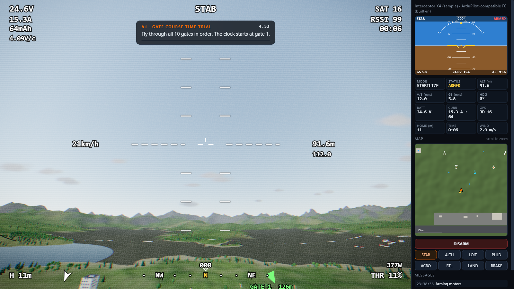
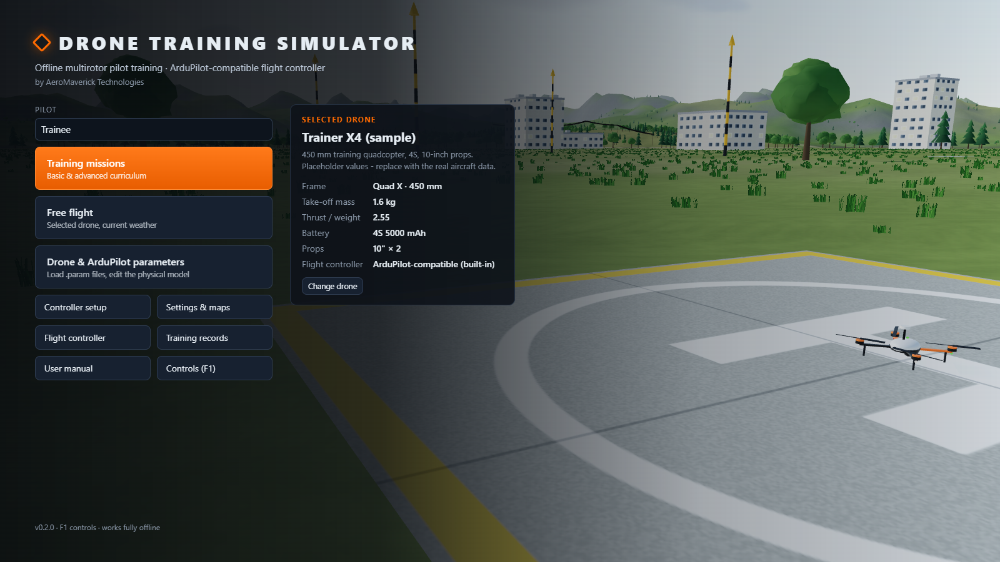
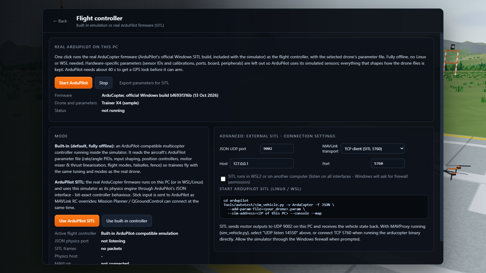
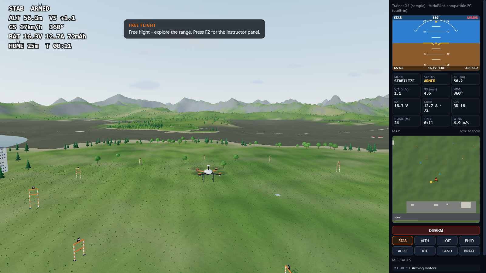
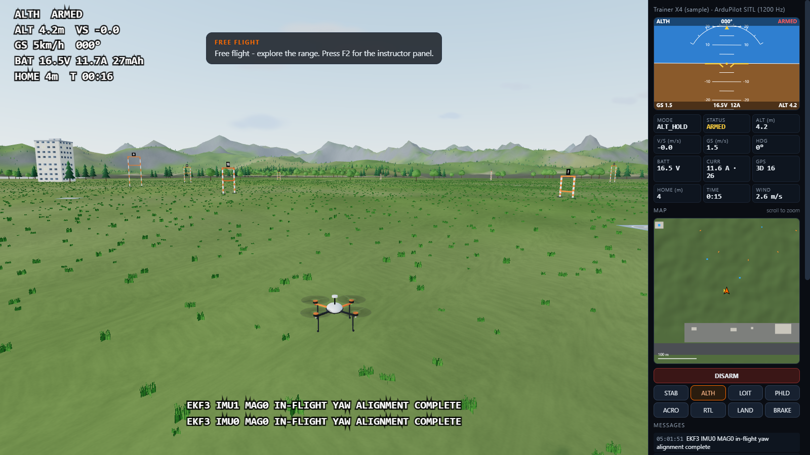
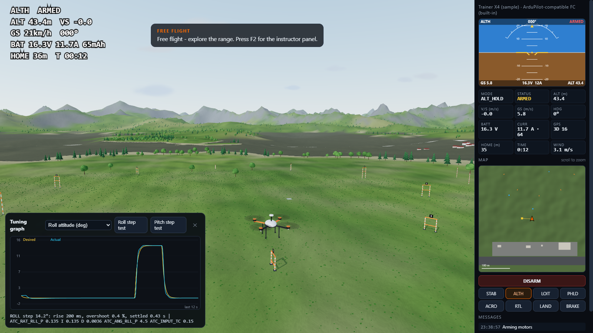
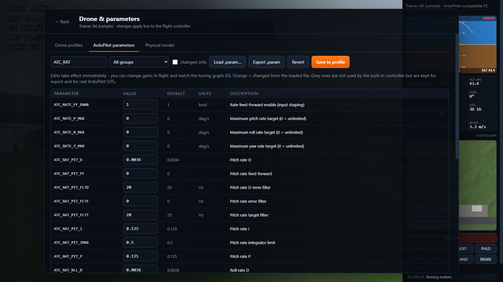
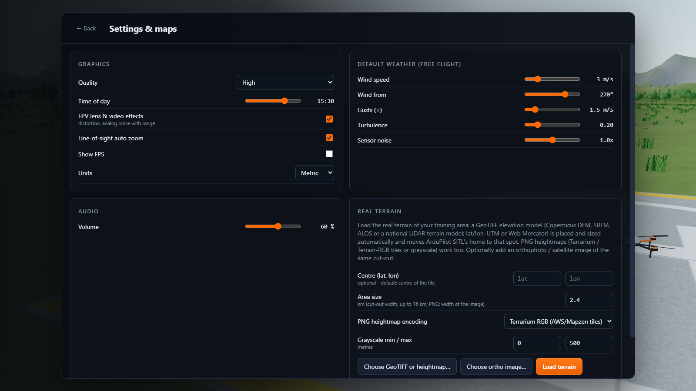
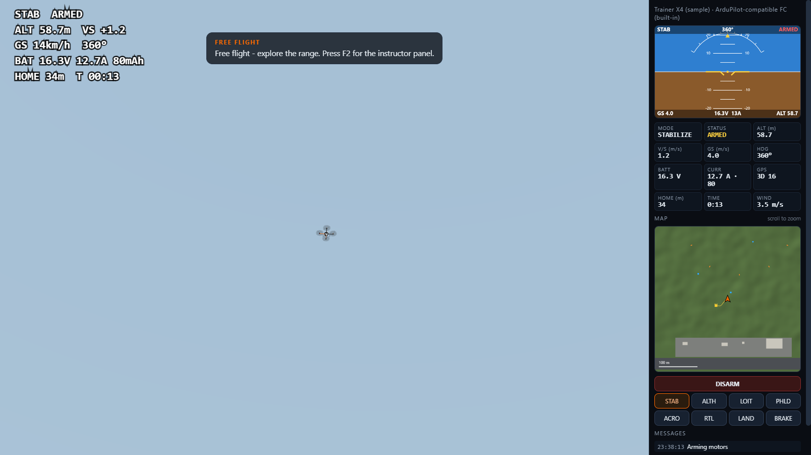

# Drone Training Simulator

**by AeroMaverick Technologies**

Offline PC simulator for multirotor pilot training. Each drone flies with its own ArduPilot parameter file, either on the built-in ArduPilot-compatible flight controller or on the real ArduPilot firmware, which is included and starts with one click.

## Download

**[Download for Windows (64-bit)](https://github.com/UnknownEng/drone-training-simulator/releases/latest)**: open the latest release and download the `.zip` under **Assets**. No installation, works fully offline.

1. Download the zip and extract it (right-click → **Extract All**).
2. Open the extracted folder and run **DroneTrainingSimulator.exe**.
3. If Windows shows "Windows protected your PC", click **More info → Run anyway**. The app is not code-signed yet.

**Requirements:** Windows 10 or 11 (64-bit), a graphics card with DirectX 11 / WebGL 2, 8 GB RAM recommended, about 300 MB of disk space. A gamepad or an RC transmitter in USB joystick mode is optional; the keyboard works too.

The full user manual opens from **User manual** in the app's main menu.

## Features

- **Real ArduPilot firmware, built in:** **Flight controller → Start ArduPilot** runs the official ArduCopter firmware as the flight controller, with the drone's own parameter file. No Linux or WSL is needed. Mission Planner or QGroundControl can watch the flight at TCP `127.0.0.1:5762`.
- **ArduPilot-compatible controller:** the built-in ArduCopter-compatible controller reads real `.param` files. It covers rate/angle PIDs with input shaping, altitude and position control, flight modes (STABILIZE, ALT_HOLD, LOITER, POSHOLD, RTL, LAND, GUIDED and more) and failsafes.
- **Your own drones:** the "Add your drone" wizard builds a flyable model from the drone's `.param` file plus its mass, size, propellers and battery. It checks the thrust-to-weight ratio and the battery settings.
- **Flight physics:** a 6-DOF model with:
  - motor spin-up lag, thrust curves and battery voltage sag;
  - ground effect, vortex-ring state and rotor drag;
  - wind with gusts and turbulence;
  - landing-gear contact and collisions with trees, buildings and wires.
- **Real terrain:** load a GeoTIFF elevation model of your training area (SRTM, Copernicus, national LiDAR). ArduPilot starts at that location.
- **Flight-log tools:** load a real ArduPilot flight log (`.bin`) to calibrate a drone's model. You can also replay the flight and compare the simulator with the real aircraft.
- **Training:** 12 missions, from first hover to advanced drills (gate course, wind and gusts, GPS failure, low battery, motor failure).
  - Scoring, debriefs and training records.
  - An instructor panel injects failures and changes the weather.
- **Radio:** gamepads and RC transmitters work as on the real aircraft. Flight modes and the arm, RTL and emergency-stop switches follow the drone's own parameters.
- **Views:** chase camera, FPV with an ArduPilot-style OSD and analog video effects, line of sight from the pilot box, and a ground-station panel.
- **Live tuning:** change PID gains in flight and see the effect in the tuning graph and the step-response test.

## Controls

| Key | Action |
|---|---|
| W / S | throttle up / down (Space = 50 %) |
| Arrow keys | pitch and roll |
| A / D | yaw |
| Enter | arm / disarm |
| 1–6 | flight-mode switch |
| H | return to launch |
| C | camera: chase / FPV / line of sight |
| Tab | ground-station panel |
| G | tuning graph |
| F1 | all controls |
| Esc | pause / menu |

Gamepads and RC transmitters work as on the real aircraft; calibrate them under **Controller setup**.

## Screenshots

| | |
|---|---|
|  |  |
|  |  |
|  |  |
|  |  |

## Flying on the real ArduPilot firmware

1. In the main menu, open **Flight controller** and click **Start ArduPilot**. The firmware starts with the selected drone's parameters.
2. Start a flight. ArduPilot needs about 40 s to get a GPS lock; the app shows a banner until the drone is ready to arm.
3. The first time, Windows Firewall may ask about **ArduCopter.exe**. Either answer works: it only talks to the simulator on this PC.

To use your own ArduPilot SITL build instead (on Linux, in WSL or on another PC), go to **Flight controller → Advanced: external SITL**.

---

© 2026 AeroMaverick Technologies. All rights reserved. The source code is not public.

The download includes ArduPilot (ArduCopter SITL, GPLv3), which runs as a separate program. Its licence and source-code links are in `resources/app/vendor/ardupilot-sitl/NOTICE.txt`. ArduPilot's source code is at https://github.com/ArduPilot/ardupilot.
